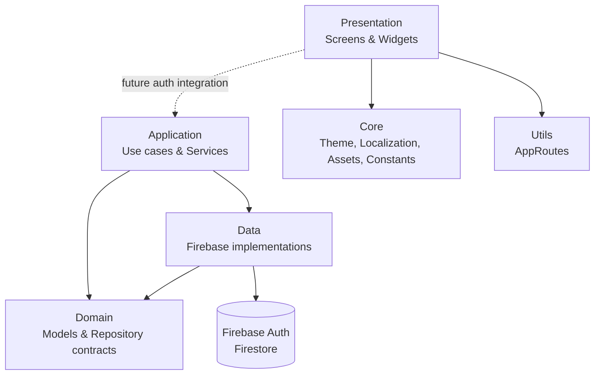
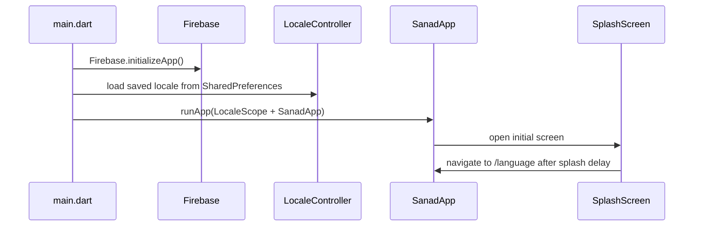
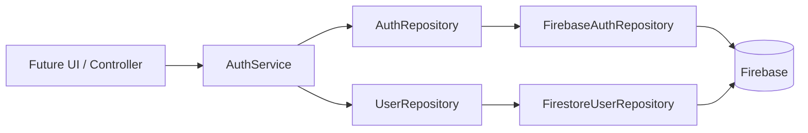

# SANAD

Context-aware medical wearable and caregiving platform built with Flutter.

هذا الملف يشرح شكل المشروع والـ Architecture الموجودة حاليًا في الكود، وليس Architecture مستقبلية أو مقترحة.

## Architecture Overview

المشروع يستخدم تقسيمًا قريبًا من **Clean Architecture** إلى أربع طبقات رئيسية:



### مسؤولية كل طبقة

| Layer | المسؤولية | الموجود حاليًا |
| --- | --- | --- |
| `presentation` | عرض الشاشات والـ widgets والتعامل مع تفاعل المستخدم | Splash، اختيار اللغة، Onboarding، اختيار الدور، Home |
| `application` | تنسيق الـ use cases وقواعد الـ workflow | `AuthService` للتسجيل وتسجيل الدخول والخروج |
| `domain` | نماذج التطبيق والـ contracts المستقلة عن Firebase | `AppUser`، `UserRole`، `AuthRepository`، `UserRepository` |
| `data` | تنفيذ الـ contracts وربطها بمصادر البيانات | Firebase Authentication و Cloud Firestore |
| `core` | الأشياء المشتركة في كل التطبيق | Theme، Localization، Assets، Constants |
| `utils` | أدوات عامة على مستوى التطبيق | تعريف الـ routes |

> ملاحظة: الـ UI الحالي لم يتم توصيله بعد بـ `AuthService`؛ الخدمة والـ repositories موجودة ومختبرة على مستوى الـ domain، لكن شاشات التسجيل/الدخول نفسها ليست ضمن الـ flow الحالي.

## Project Structure

```text
sanad/
├── android/                         # Android native project files
│   └── app/
├── ios/                             # iOS native project files
│   └── Runner/
├── assets/
│   ├── fonts/
│   │   ├── ar/                      # Tajawal: Arabic font family
│   │   └── en/                      # Poppins: English font family
│   ├── images/
│   │   ├── sanad_logo.png
│   │   ├── ic_home.png
│   │   ├── ic_chat.png
│   │   ├── ic_search.png
│   │   ├── ic_setting.png
│   │   ├── forward_arrow.png
│   │   ├── back_to_left.png
│   │   └── back_to_right.png
│   └── lottie/
│       └── role_selection.json
├── lib/
│   ├── application/
│   │   └── auth/
│   │       ├── auth_service.dart
│   │       ├── auth_failure.dart
│   │       └── auth_service_exception.dart
│   ├── core/
│   │   ├── assets/
│   │   │   └── app_assets.dart
│   │   ├── constants/
│   │   │   └── app_constants.dart
│   │   ├── localization/
│   │   │   ├── app_localizations.dart
│   │   │   ├── locale_controller.dart
│   │   │   └── locale_scope.dart
│   │   ├── model/                   # موجود حاليًا بدون ملفات
│   │   └── theme/
│   │       └── app_color.dart
│   ├── data/
│   │   └── repositories/
│   │       ├── firebase_auth_repository.dart
│   │       └── firestore_user_repository.dart
│   ├── domain/
│   │   ├── models/
│   │   │   ├── app_user.dart
│   │   │   └── user_role.dart
│   │   └── repositories/
│   │       ├── auth_repository.dart
│   │       └── user_repository.dart
│   ├── firebase_options.dart         # Generated Firebase platform config
│   ├── main.dart                     # App entry point
│   ├── presentation/                 # Presentation layer
│   │   ├── screens/
│   │   │   ├── splash_screen/
│   │   │   │   └── splash_screen.dart
│   │   │   ├── language_screen/
│   │   │   │   └── language_screen.dart
│   │   │   ├── onboarding/
│   │   │   │   └── onboarding_screen.dart
│   │   │   ├── role_selection/
│   │   │   │   └── role_selection_screen.dart
│   │   │   ├── login_screen/
│   │   │   │   └── login_screen.dart
│   │   │   ├── signup_screen/
│   │   │   │   └── signup_screen.dart
│   │   │   ├── verification_method_screen/
│   │   │   │   └── verification_method_screen.dart
│   │   │   ├── otp_verification_screen/
│   │   │   │   └── otp_verification_screen.dart
│   │   │   └── home_screen/
│   │   │       └── home_screen.dart
│   │   └── widgets/
│   │       ├── sanad_brand.dart
│   │       ├── sanad_button.dart
│   │       ├── auth/
│   │       │   ├── auth_header.dart
│   │       │   ├── auth_text_field.dart
│   │       │   ├── password_requirements.dart
│   │       │   ├── verification_method_card.dart
│   │       │   └── otp_input.dart
│   │       └── onboarding_illustrations.dart
│   └── utils/
│       └── routes.dart
├── test/
│   ├── domain/
│   │   ├── app_user_test.dart
│   │   └── user_role_test.dart
│   └── widget_test.dart
├── firebase.json
├── pubspec.yaml
├── analysis_options.yaml
└── SANAD_PROJECT_CONTEXT.md          # Product brief and scope
```

## Application Startup



## Current Navigation Flow

```text
SplashScreen
    ↓  /language
LanguageScreen
    ↓  /onboarding
OnboardingScreen
    ↓  /role-selection
RoleSelectionScreen
    ↓  /login
LoginScreen ⇄ SignUpScreen
    ↓  /verification-method
VerificationMethodScreen
    ↓  /otp-verification
OTP presentation preview
```

الـ routes يتم تعريفها وتشغيلها من خلال `lib/utils/routes.dart` باستخدام `onGenerateRoute`.

### Available Routes

| Route | Screen | الغرض |
| --- | --- | --- |
| `/` | `SplashScreen` | شاشة البداية |
| `/language` | `LanguageScreen` | اختيار العربية أو الإنجليزية |
| `/onboarding` | `OnboardingScreen` | شرح فكرة SANAD في 5 صفحات |
| `/role-selection` | `RoleSelectionScreen` | اختيار Patient أو Caregiver |
| `/login` | `LoginScreen` | واجهة تسجيل الدخول المحلية فقط |
| `/signup` | `SignUpScreen` | واجهة إنشاء الحساب والتحقق المحلي فقط |
| `/verification-method` | `VerificationMethodScreen` | اختيار طريقة التحقق في المعاينة |
| `/otp-verification` | `OtpVerificationScreen` | واجهة OTP للمعاينة فقط |
| `/home` | `HomeScreen` | الصفحة الرئيسية الحالية |

## Localization Flow

1. `main.dart` ينشئ `LocaleController`.
2. يتم تحميل اللغة المحفوظة من `SharedPreferences` قبل رسم التطبيق.
3. `LocaleScope` يوفّر الـ controller لكل الشاشات عن طريق `InheritedNotifier`.
4. `SanadApp` يغيّر الـ theme والـ `Directionality` حسب اللغة.
5. العربية تستخدم RTL و `Tajawal`، والإنجليزية تستخدم LTR و `Poppins`.

## Authentication and Data Flow



### Registration

1. `AuthService.register()` ينشئ حسابًا في Firebase Authentication.
2. يتم إنشاء `AppUser` بالدور المختار.
3. يتم حفظ profile داخل collection اسمها `users` في Firestore.
4. لو فشل حفظ الـ profile، تحاول الخدمة حذف حساب Firebase لمنع وجود account ناقص.

### Sign in

1. يتم تسجيل الدخول عبر Firebase Authentication.
2. يتم تحميل profile من `users/{uid}`.
3. لو الـ profile غير موجود أو غير صالح، يتم عمل sign out وإرجاع exception مناسبة.

## Dependencies

- `firebase_core`: تهيئة Firebase.
- `firebase_auth`: إنشاء الحسابات وتسجيل الدخول.
- `cloud_firestore`: تخزين user profiles.
- `shared_preferences`: حفظ اللغة المختارة.
- `lottie`: تشغيل animation اختيار الدور.
- `flutter_localizations`: دعم الترجمة واتجاه النص.

## Testing

الاختبارات الموجودة حاليًا تغطي:

- تحويل `UserRole` من وإلى قيم Firestore.
- تحويل `AppUser` إلى/from Firestore-compatible data.
- رفض البيانات غير الصحيحة.
- رحلة الـ UI من Splash إلى Language ثم Onboarding ثم Role Selection ثم Auth UI.
- تبديل RTL/LTR والـ fonts حسب اللغة.
- اختبار أحجام شاشات موبايل مختلفة.
- التحقق المحلي لنماذج المصادقة، متطلبات كلمة المرور، اختيار البريد الإلكتروني،
  عدم توفر SMS، وإدخال OTP في المعاينة.

لتشغيل الاختبارات:

```bash
flutter test
```

لتشغيل static analysis:

```bash
flutter analyze
```

لتشغيل التطبيق:

```bash
flutter pub get
flutter run
```

## Current Notes

- تم توحيد اسم مجلد الـ presentation حاليًا إلى `presentation`.
- مجلد `lib/core/model/` موجود لكنه فارغ حاليًا؛ الـ models المستخدمة فعليًا موجودة في `lib/domain/models/`.
- `AppConstants` يحتوي بعض الثوابت القديمة الخاصة بمترو القاهرة بجانب ثوابت SANAD، ويحتاج تنظيفًا عندما يبدأ تطوير features المنتج الأساسية.
- Firebase configuration موجودة لـ Android و iOS فقط في `lib/firebase_options.dart`؛ باقي المنصات غير مفعّلة حاليًا.

لمزيد من تفاصيل المنتج والـ scope، راجع [`SANAD_PROJECT_CONTEXT.md`](SANAD_PROJECT_CONTEXT.md).
